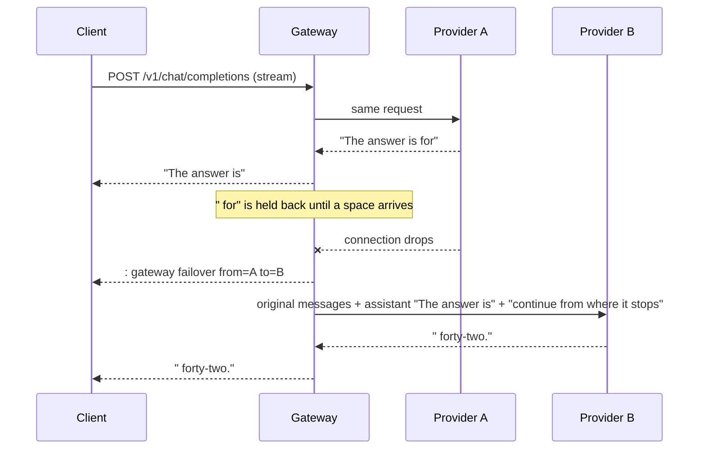

# go-llm-gateway

[](https://github.com/jamesvincentsiauw/go-llm-gateway/actions/workflows/ci.yml)

An OpenAI-compatible gateway in Go that sits in front of several LLM providers. When a provider fails, the gateway moves the request to the next one, and it can do that in the middle of a streamed answer: the client keeps the words it already has, and the next provider continues from there.

It also enforces per-client daily token quotas in Redis, trips a circuit breaker on providers that keep failing, and exports Prometheus metrics. Providers today are Claude, through the official [Anthropic Go SDK](https://github.com/anthropics/anthropic-sdk-go), and anything that speaks the OpenAI chat completions API.

## Failing over mid-stream

Switching providers is easy before the first byte reaches the client. After that, a dropped connection usually leaves the client with half an answer and a request to start over. This gateway handles the second case too.



The gateway only forwards text up to the last whitespace it has seen and holds the rest. When a provider drops, the held partial word is thrown away, so the next provider never has to finish half a word.

Current Claude models reject assistant prefill, so the text the client already received is sent as a finished assistant turn, followed by a short instruction to continue from where it stops without repeating anything. OpenAI-compatible providers get the same request shape.

The continuation gets the original `max_tokens` minus an estimate of what was already sent. If nothing is left, the answer ends with `finish_reason: "length"`.

Each switch is written to the stream as an SSE comment (`: gateway failover from=A to=B`). The SSE format tells clients to ignore comment lines, so existing client code keeps working. Non-streaming responses list the switches in an `x_gateway` field and an `X-Gateway-Upstreams` header.

The seam is best effort. A different model may phrase the rest differently or repeat a word. The end-to-end tests check exact stitching against a scripted provider that resumes precisely; real models will be close, not identical.

## Other behavior

**When to try the next provider.** Connection drops, timeouts, 408, 409, 429, 5xx, and also 401 and 403, since those point at the gateway's credentials for that provider rather than at the request. Other 4xx responses go straight back to the client as a 400, because every provider would reject the same request.

**Stall timeout.** If a provider sends nothing for `stall_timeout`, the attempt is cancelled and counted as a failure. Any event resets the timer, not only text. A Claude model can still stay silent while it thinks before its first word, so the default is a generous 60 seconds.

**Circuit breakers.** Each provider has a breaker that opens after `breaker.failures` consecutive failures. While open, the provider is skipped. After `breaker.cooldown`, one trial request goes through, and its result closes or reopens the breaker. Client disconnects and rejected requests do not count as failures.

**Quotas.** Before calling any provider, the gateway reserves the request's worst case in Redis: an input estimate (4 bytes per token) plus `max_tokens`. A Lua script checks and increments atomically, so concurrent requests cannot overshoot the daily limit. After the response, the reservation is settled to the usage the providers reported. The cost is that reservations are pessimistic under burst traffic: in one integration test run, 40 concurrent requests against a 3,000 token limit let 14 through and rejected 26 with 429, while actual usage was 1,022 tokens. Callers that set a realistic `max_tokens` get more requests through.

**Claude specifics.** The adapter calls the Messages API through the official SDK with its retries turned off, since the gateway makes that decision. It drops `temperature` and `top_p`, which current Claude models reject. With `refusal_fallbacks: true` it sets `fallbacks: "default"`, so when a model's safety classifier declines a request, the Claude API re-runs it on Anthropic's recommended fallback model inside the same call. That covers refusals; the gateway's own failover covers provider outages. A refusal that still comes back is returned as `finish_reason: "content_filter"` and is not retried elsewhere.

## Run it

Requirements: Go 1.25+, Docker.

```bash
make up     # Redis, a scripted fake provider, and the gateway on :8080
make demo   # stream a route whose first provider drops after 12 words
```

The demo config ([deploy/demo.yaml](deploy/demo.yaml)) needs no API keys. Its routes:

| Model | What happens |
| --- | --- |
| `demo` | One healthy provider |
| `demo-flaky` | The first provider drops mid-answer, the backup finishes it. After three requests its breaker opens and the backup answers directly |
| `demo-down` | Both providers fail before any output, the client gets a 503 |
| `claude` | Claude first, the fake provider second. Without `ANTHROPIC_API_KEY`, Claude returns 401 and the backup answers |

Any OpenAI client works against it:

```python
from openai import OpenAI

client = OpenAI(base_url="http://localhost:8080/v1", api_key="demo-key")
stream = client.chat.completions.create(
    model="demo-flaky",
    messages=[{"role": "user", "content": "Why fail over mid-stream?"}],
    stream=True,
)
for chunk in stream:
    print(chunk.choices[0].delta.content or "", end="")
```

If ports are taken, set `GATEWAY_PORT` and `REDIS_PORT` before `make up`.

## Configuration

[gateway.example.yaml](gateway.example.yaml) shows a production-style setup. Clients send a route name as `model`, and each route lists upstream models in the order they are tried. API keys never live in the file: each provider and client names the environment variable that holds its key. Incoming keys are matched by their SHA-256 hash.

| Setting | Default | |
| --- | --- | --- |
| `listen` | `:8080` | |
| `redis_url` | `redis://localhost:6379/0` | |
| `stall_timeout` | `60s` | Longest silence allowed from a provider |
| `default_max_tokens` | `4096` | Used when the request sets neither `max_tokens` nor `max_completion_tokens` |
| `max_tokens_limit` | `64000` | Requests above this get a 400 |
| `breaker.failures` | `3` | Consecutive failures before a provider is skipped |
| `breaker.cooldown` | `30s` | Time before a trial request |
| `clients[].daily_token_limit` | | `0` means unlimited |

Endpoints: `POST /v1/chat/completions`, `GET /v1/models`, `GET /healthz` (checks Redis), `GET /metrics`.

## Metrics

| Metric | Labels |
| --- | --- |
| `gateway_requests_total` | `route`, `status` |
| `gateway_upstream_attempts_total` | `provider`, `outcome`: ok, failed, stalled, rejected, breaker_open |
| `gateway_failovers_total` | `from`, `to`, `kind`: before_output, mid_stream |
| `gateway_breaker_state` | `provider`: 0 closed, 1 open, 2 half-open |
| `gateway_tokens_total` | `client`, `direction` |
| `gateway_request_duration_seconds` | `route` |

## Tests

```bash
make test               # unit tests
make test-integration   # needs Redis, e.g. after make up; set REDIS_URL if it is not on localhost:6379
make lint
```

The failover engine is tested with scripted providers (drops before and after output, stalls, heartbeats, rejected requests, client disconnects, spent token budgets) and end to end through the real OpenAI adapter against [internal/fakellm](internal/fakellm), a scripted server that can drop the connection after N words and resume a continuation at the right word. The Claude adapter is tested against a local server that replays Messages API events, including a dropped stream and error statuses; the test suite never calls the real API. The integration test sends 40 concurrent requests through the gateway and checks that the counter in Redis equals the usage the clients received and stays under the limit.

## Limitations

- Text only. Tool calls, images and other content parts are rejected with a 400.
- A provider that drops mid-answer does not report usage, so its tokens are missing from the settled quota and the metrics. The provider may still bill for them.
- Input tokens are estimated at 4 bytes per token for reservations. Real counts differ by model and language.
- Circuit breakers live in process memory, so each gateway replica learns about a failing provider on its own.
- A failover writes an SSE comment, not a structured event. Clients that want to react to it need to read comments.
- The Claude adapter has only been exercised against recorded event shapes in tests, not against the live API.
